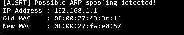

# ARP Mapping Change Monitor

A defensive Python/Scapy tool for watching ARP replies and identifying changes to previously observed IP-to-MAC mappings in a lab network.

## Provenance

This implementation was **reconstructed and extended** for the public portfolio using evidence from **SIT379 Ethical Hacking, Module 5 Task C, PDF pages 129–133**. It is **not** presented as the original university submission. The university report documented a working detector and a controlled spoofing test.

## How it works

1. Capture ARP replies on the selected interface.
2. Record the first observed mapping for each source IP.
3. Compare later observations against the stored mapping.
4. Display an alert when the mapping changes.

## Setup

Python 3.10+ recommended. For live packet capture, install Scapy:

```bash
python -m pip install scapy
sudo python arp_detector.py --interface eth0
```

Packet capture may require elevated privileges. Run only on networks you are authorised to monitor.

## Tests

The core mapping logic can be tested without Scapy or live network access:

```bash
python -m unittest discover -s tests -v
```

## Evidence from the university lab

- PDF page 131: original script shown in terminal.
- PDF page 132: baseline monitoring and controlled ARP spoofing simulation.
- PDF page 133: detector output indicating the original MAC and newly observed MAC.

## Limitations

A changing ARP mapping is an **indicator**, not proof of malicious spoofing. Legitimate device replacement, interface changes, failover and virtual network changes can also create alerts. This version keeps an in-memory baseline, has no durable log, no trusted-mapping file and no alert correlation. A production-grade monitor should use trusted baselines, context, logging and alert prioritisation.

## Security

This repository contains defensive monitoring code only and synthetic observations for tests. It does not include attack automation, credentials or live packet captures.

## Original university evidence

The following images were cropped from the university submission and enhanced for contrast. They are distinct from output of the reconstructed Python code.

**Baseline ARP mapping, SIT379 page 132**


**Changed mapping alert, SIT379 page 133**



See [the evidence register](../../docs/arp-evidence-register.md) for source page references, image processing and limits on what the screenshots prove.

**[View the public portfolio case study](https://devv000-git.github.io/#project/arp-detector)**
