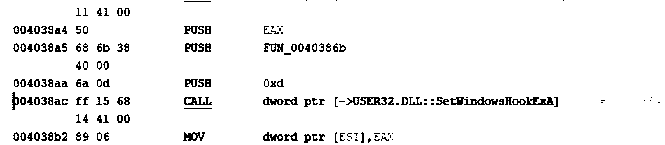
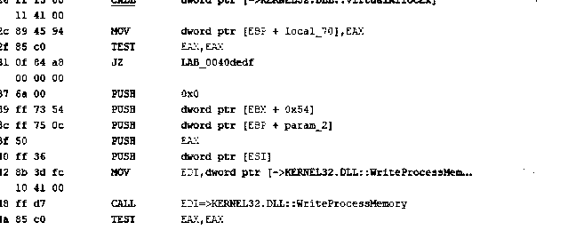
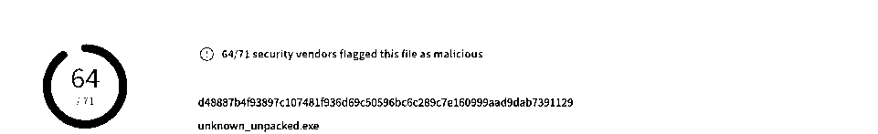

# Malware Reverse Engineering and MITRE ATT&CK Mapping

**Unit:** SIT324 Malware Analysis  
**Academic exercises:** Task 10.1 (Ghidra reverse engineering) and Task 10.2 (malware campaign and MITRE ATT&CK report)  
**Source document:** Private SIT324 university portfolio PDF, pages **241–264** (2026)  
**Tools documented:** Ghidra 10.1.5, VirusTotal, MITRE ATT&CK Enterprise  
**Environment documented:** Windows 10 virtual machine

## Summary

Analysed the supplied Windows PE file `unknown_unpacked.exe` using Ghidra and documented its suspicious Windows API behaviour. Correlated the reverse engineering findings with a **historical VirusTotal report** and mapped supported findings to ATT&CK techniques.

This is an **authorised academic malware-analysis exercise**, not a claim of a real-world incident response engagement. The sample is **not** distributed.

## Evidence-backed findings

| Area | Reported function or evidence | Source PDF page | Interpretation and limitations |
| --- | --- | --- | --- |
| Low-level keyboard hook | `SetWindowsHookExA` called with `0xd` (WH_KEYBOARD_LL) and callback `FUN_0040386b` | **248** | Direct call-site evidence supports **keyboard-monitoring capability**. It does not independently prove recorded keystrokes left the host. |
| Keyboard-state processing | Callback `FUN_0040386b` forwards to `FUN_004038ea`, which calls `GetKeyState(0x14)` and `CallNextHookEx` | **249–250** | Supports investigation of input capture. |
| Token privilege handling | `FUN_0040d2fb` calls `GetCurrentProcess`, `OpenProcessToken`, `LookupPrivilegeValueA` and `AdjustTokenPrivileges`, requesting `SeShutdownPrivilege` | **251–252** | Evidence of **attempted token-privilege adjustment**, not by itself proof of escalated access. |
| Remote-process memory operations | `FUN_0040dd31` includes `VirtualAllocEx` and `WriteProcessMemory` | **252–253** | Indicates **process-injection-related code**. The excerpt alone does not show a successful injection or an executing remote thread. |
| VirusTotal detection | The report screenshot showed **64/71** engines flagging `unknown_unpacked.exe`, labelled `trojan/remcos/dacic` | **257–258** | Historical external detections support malicious classification. The vendor ratio is **not** a score achieved by this project. |
| Threat mapping | A report table mapped Windows API findings and VirusTotal information to ATT&CK techniques | **261–263** | Some entries are **code-supported**, some from **VirusTotal**, and others are **scenario assumptions**. |

## Original screenshot evidence

These are contrast-enhanced monochrome **crops of screenshots embedded in the original student report**, not recreation output or proof of rerunning malware.

**Ghidra: low-level keyboard hook, source PDF p. 248**

**Ghidra: remote-process memory APIs, source PDF p. 253**

**VirusTotal: detection snapshot, source PDF p. 258**

[Detailed evidence and provenance register](../../docs/malware-analysis-evidence-register.md)

## Selected ATT&CK mappings

The following represent the source report's analysis, not independent validation of every technique:

| Technique | ID | Evidence type | Basis |
| --- | --- | --- | --- |
| Input Capture: Keylogging | **T1056.001** | **Direct Ghidra API evidence** | `SetWindowsHookExA`, `GetKeyState`, `CallNextHookEx` |
| Process Injection | **T1055** | **Ghidra API indicators** | `VirtualAllocEx`, `WriteProcessMemory` |
| Access Token Manipulation | **T1134** | **Ghidra privilege API indicators** | `OpenProcessToken`, `AdjustTokenPrivileges` |
| Boot or Logon Autostart Execution: Registry Run Keys / Startup Folder | **T1547.001** | **VirusTotal code-insight report** | Run key and Winlogon persistence reported by external analysis |
| Phishing: Spearphishing Attachment | **T1566.001** | **Lab scenario assumption only** | The assignment supposes delivery through a phishing attachment. No email specimen is included. |
| User Execution: Malicious File | **T1204.002** | **Scenario assumption** | The task assumes a recipient executes the delivered file. |

ATT&CK mappings are best interpreted as **analyst classifications of evidence or hypotheses**. For example, the observed allocation and memory-write API pattern makes process injection plausible but is not runtime proof that an injected payload executed.

## Historical sample identifiers

From the academic report, PDF pages 257 and 264:

- Submitted sample name: `unknown_unpacked.exe`
- Type: Windows PE32 executable (x86)
- Size: 102,400 bytes
- MD5: `5c149f14d2f9ee277f3387b15a1ee143`
- SHA-256: `d48887b4f93897c107481f936d69c50596bc6c289c7e160999aad9dab7391129`
- Recorded external label: `trojan/remcos/dacic`
- Recorded external detection result: **64/71** in the supplied screenshot

These are **historical laboratory artifacts**. The repository does not assert the same detection ratio or labels today.

## Defensive implications proposed in the report

- Review and restrict unexpected executable email attachments.
- Correlate endpoint process/memory behaviour and suspicious API patterns with EDR telemetry.
- Monitor unusual registry autostart modifications and suspicious Windows process ancestry.
- Apply least privilege and application control.
- Handle observed external destinations through an approved intelligence validation process before blocking.
- Preserve sufficient telemetry to determine whether detected capabilities resulted in malicious execution.

These are **recommendations**, not controls documented as deployed during the lab.

## Reproducibility and limitations

**Available for verification:** source-page references, the 3 original screenshot crops, technical findings, defensive suggestions and ATT&CK rationale.

**Not available publicly:** original malicious executable, Ghidra project database, dynamic execution artifacts, raw network capture or full university submission. The present portfolio work **did not rerun the malware**. Code snippets described above are visible in the original report but have not been reconstructed into executable project source. Downloading or executing malicious samples is **not necessary** to review this case study.

[View the live case study](https://devv000-git.github.io/#project/malware-analysis)
