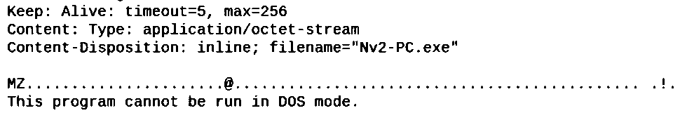

# Malware Network Traffic Investigation

**Source:** SIT327 Network Forensics, Pass Task 5.1P, university portfolio PDF pages 49–59 (2026)  
**Environment:** Wireshark, Linux virtual machine, provided historical PCAP  
**Focus:** Host identification, network traffic triage, HTTP payload delivery and suspected follow-on communication

## Investigation question

A simulated forensic case describes a laptop that may have been infected following use of a public network. The task was to identify the host within a supplied packet capture, inspect its traffic and assess whether suspicious downloads or later communications were present.

This is an **academic investigation of a supplied capture**, not a professional incident response engagement. The PCAP is not included in this repository.

## Investigative workflow

1. Open the supplied PCAP in Wireshark.
2. Identify the primary internal host through **Statistics > Endpoints**, including IPv4 and Ethernet views.
3. Review DNS queries and TCP conversations to find external services contacted.
4. Filter HTTP requests and identify a suspicious archive-named download.
5. Follow the related TCP stream to examine the HTTP response and visible payload characteristics.
6. Record suspected follow-on activity and distinguish direct packet evidence from statements appearing only in the report.

## Directly documented findings

| Indicator | Observation | Provenance |
| --- | --- | --- |
| Internal host | `172.16.254.128` | Wireshark endpoint figure, report pp. 50–52 |
| Lab MAC | `00:0c:29:b6:b5:48` | Ethernet endpoint evidence, report p. 52 |
| External endpoint | `81.166.122.238` | Investigator's traffic table and discussion, pp. 53–54 |
| HTTP request | `GET /nv2/Nv2-PC.zip HTTP/1.1` to `www.harveycartel.org` | TCP stream screenshot, report p. 56 |
| HTTP response | `Content-Disposition: inline; filename="Nv2-PC.exe"` | Same screenshot, report p. 56 |
| Executable characteristics | `MZ` and DOS-stub text visible in response body | Same screenshot, report p. 56 |
| Possible later communication | POSTs to `ninja-game.org` described as containing local Windows paths | Written investigation, pp. 58–59. A corresponding POST screenshot is **not provided** in these pages |

**Interpretation:** The observed HTTP stream supports delivery of Windows executable content under a misleading archive-style request path. It does **not**, by itself, prove that the executable ran, that exfiltration occurred, or that an endpoint was compromised.

The report discusses possible command-and-control or data exfiltration. Treat this as an investigative hypothesis until verified against original packets or endpoint telemetry.

## Original lab screenshot evidence

The crops below are taken from the submitted PDF and were converted to high-contrast monochrome for legibility. They are **not** recreated terminal output.

**Endpoint identification, PDF p. 52**


**HTTP request, PDF p. 56**


**HTTP response and executable characteristics, PDF p. 56**



See the [evidence register](../../docs/network-forensics-evidence-register.md) for page-level provenance and the excluded screenshot.

## Useful Wireshark display filters

These are filters documented in the original report:

```text
ip.addr == 172.16.254.128
dns && ip.addr == 172.16.254.128
http.request
http && ip.addr == 172.16.254.128
ip.addr == 81.166.122.238
tcp.stream eq 142
```

## Defensive recommendations

These are **proposed** actions, not controls proven to have been deployed during the lab:

- Correlate a suspicious network download with endpoint process and file telemetry.
- Preserve proxy, DNS and firewall logs to build a timeline.
- Validate hashes and destinations using an approved threat-intelligence process.
- Investigate repeated or structured outbound POST requests in context.
- Apply application control and endpoint protection suitable to the environment.

## Limitations and safe handling

- Only the PDF documentation was available for this portfolio update. The original PCAP was **not reanalysed**.
- The screenshot included on report p. 57 is a different TCP stream showing a JPEG request. It does not corroborate the executable delivery and has intentionally been excluded.
- Domains and addresses are included as historical **lab evidence**, not as current threat intelligence. Do not visit them or draw conclusions about their present status.
- Malware files and raw traffic captures are not distributed.

[**View the portfolio case study**](https://devv000-git.github.io/#project/malware-pcap)
