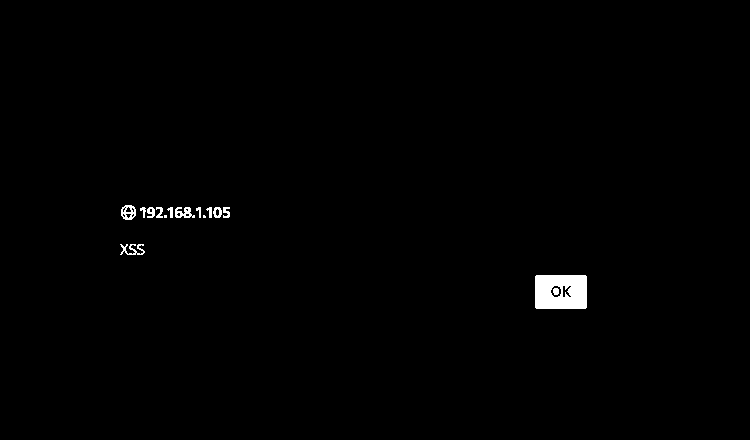
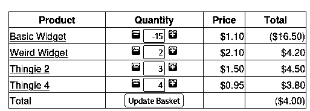
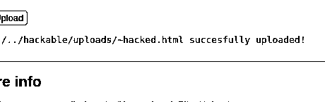

# Web Application Security Assessment

**University source:** SIT379 Ethical Hacking, Tasks 8.1P and 8.2C, PDF pages 224–255 (2026)  
**Authorised targets:** The BodgeIt Store and DVWA (intentionally vulnerable laboratory applications)  
**Tools:** Burp Suite Proxy and Repeater, browser developer workflow, HTTP request analysis

## Overview

Performed controlled web-application testing to identify how insecure handling of requests, user-supplied inputs and uploads can affect application behaviour. Two related university assessment tasks document XSS, SQL injection, an HTTP method weakness, cart quantity manipulation, and an unsafe file upload control.

All activities were restricted to deliberately vulnerable lab applications. These are **academic exercises**, not client penetration tests.

## Evidence-based findings

| Finding | Lab | Observation | PDF |
| --- | --- | --- | --- |
| Reflected cross-site scripting | BodgeIt Store | A search-field payload produced a browser alert in the immediate response | **228**, Figure 3 |
| Stored cross-site scripting | BodgeIt Store | A registration payload produced an alert in the registration workflow | **229**, Figures 4–5 |
| SQL injection / authentication bypass | BodgeIt Store | A manipulated username was accepted and the application indicated login success | **230**, Figure 6 |
| Sensitive action accepted over GET | DVWA lab | A password-change operation returned HTTP 200 and confirmation when sent as GET | **244–246**, Figure 5 on p. 246 |
| Negative quantity accepted | BodgeIt Store | A manipulated basket quantity of **-15** produced a **($4.00)** basket total | **248–250**, Figure 8 on p. 249 |
| Inadequate upload MIME validation | DVWA Medium | An HTML file blocked initially was accepted after the submitted MIME type was changed to an image type | **251–254**, Figures 10–13 |

## Representative original screenshot evidence

The following screenshots are cropped from the **original university assessment**, converted to high-contrast monochrome. They are not demonstrations performed against a live public service.

### Reflected XSS, page 228

The browser alert confirms script execution within the intentionally vulnerable search workflow.

### File-upload MIME handling, page 252

The captured request shows the submitted metadata. The **successful upload** is separately documented in the source report on page 253. A request modification alone does not establish success.

### Business logic: negative basket total, page 249

### File upload success, page 253

The upload request and upload success screenshots are separate pieces of evidence. The first demonstrates a client-supplied MIME mismatch. The second shows the application accepted the file.

## Technical reasoning and recommended fixes

### XSS

**Observation:** Browser output rendered untrusted script content in either the search response or registration workflow.

**Why it matters:** Script execution in an application's origin may permit malicious actions in the browser context.

**Mitigation:** Context-aware output encoding, safe templating, appropriate input handling and a restrictive Content Security Policy as a second line of defence.

### SQL injection

**Observation:** The BodgeIt Store accepted a login after a tautological condition was submitted through the username field.

**Mitigation:** Parameterised SQL queries, server-side authentication checks and safe error messages.

### Password changes over GET

**Observation:** The lab accepted a request to modify a password when sensitive values were provided as URL parameters in a GET request.

**Mitigation:** Require appropriate state-changing methods, verify the current authenticated session, enforce CSRF protections, and never include passwords in URLs.

### Basket business logic

**Observation:** A negative item quantity was accepted and calculated into a negative cart total.

**Mitigation:** Reject invalid quantities on the server and independently recalculate pricing and totals based on server-controlled values.

### File upload

**Observation:** A file bearing an HTML extension was accepted after the request-supplied Content-Type was altered. The report further shows the uploaded file rendered as HTML in the browser.

**Mitigation:** Validate allowed types using server-side checks, independently inspect content, randomise safe filenames, isolate storage and prevent uploaded content from executing as active material.

**Precision:** The lab uploaded and displayed an HTML document containing a message. Although the report uses the term “script executed,” the demonstrated evidence does **not** prove arbitrary operating-system command execution or remote code execution.

## STAR summary

**Situation:** Deliberately vulnerable applications exposed common input and server-side validation problems.  
**Task:** Demonstrate and document exploitable weaknesses in an authorised lab.  
**Action:** Inspected browser interactions and HTTP requests using Burp Suite, reviewed application responses and evaluated the effect of controlled input changes.  
**Result:** Documented XSS, an authentication weakness, insecure request handling, negative quantity acceptance and bypass of client-provided upload MIME checks, with evidence and defensive recommendations.

## Evidence and scope

See the [source evidence register](../../docs/web-security-evidence-register.md) for detailed page references and confidence statements.

Original test targets, screenshots, timestamps and account names are those of an isolated university environment. No credentials, full assessment PDF or exploit code are distributed in this repository.

[**View the portfolio case study**](https://devv000-git.github.io/#project/web-security)
